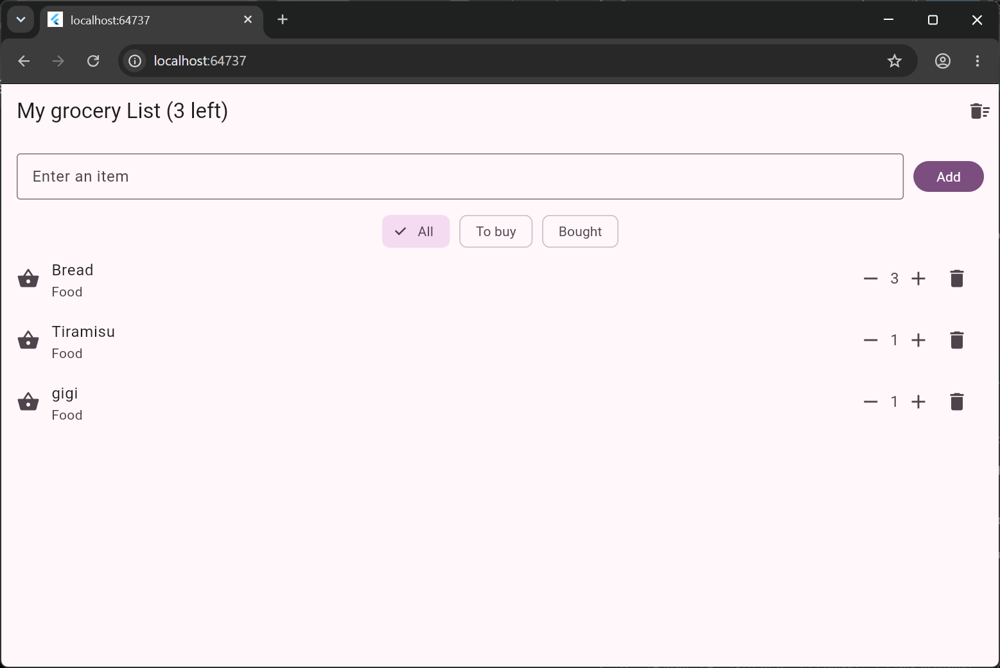
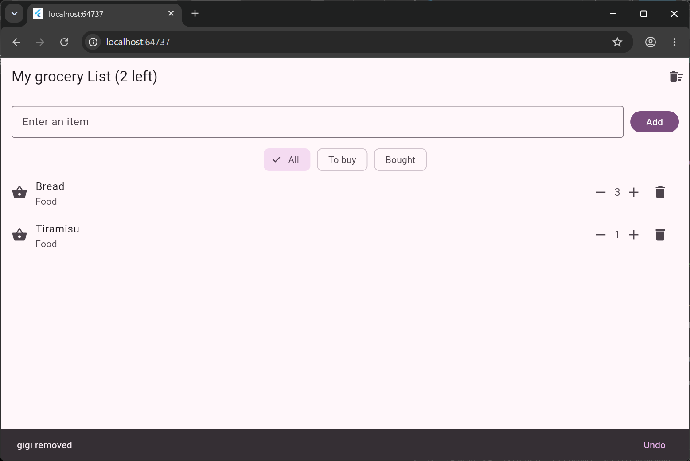
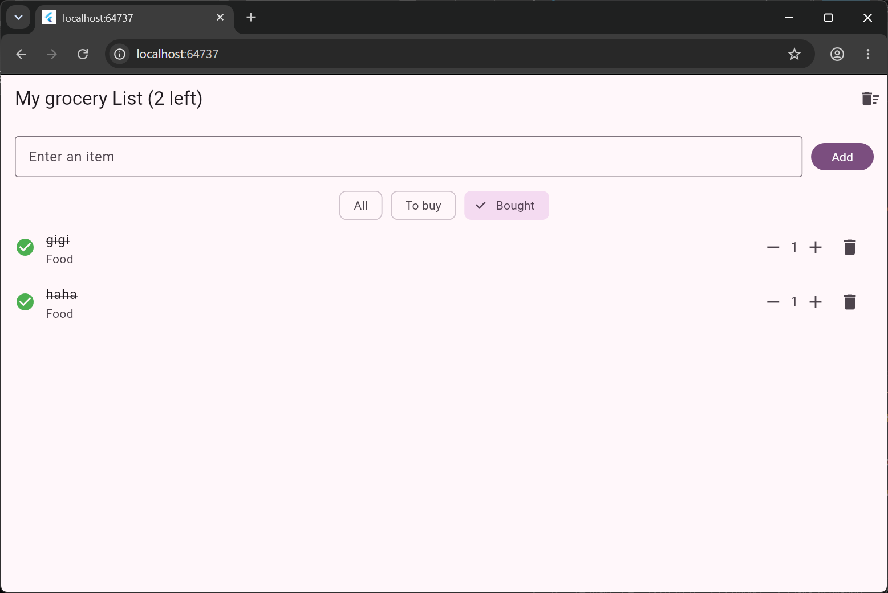

# Shopping List+

A Flutter shopping list application that helps users organize shopping items, manage quantities, track purchased items, and edit item details.

Built using **Flutter and Dart**.

## Features

### 1. Empty List Message
- Displays "Your list is empty" when there are no shopping items.
- Automatically displays the list again when a new item is added.

### 2. Item Quantities
- Every item starts with a quantity of 1.
- Users can increase or decrease quantities using the + and − buttons.
- Quantities cannot go below 1.

### 3. Duplicate Item Handling
- Adding an existing item increases its quantity instead of creating another row.
- Duplicate detection ignores capitalization and surrounding spaces.
- A message displays the updated quantity.

### 4. Delete and Undo
- Users can delete individual shopping items.
- A SnackBar displays an Undo button after deletion.
- Undo restores the item to its original position with its quantity and bought status preserved.

### 5. Shopping List Filters
- **All:** Displays every item, with bought items at the bottom.
- **To buy:** Displays only items that have not been bought.
- **Bought:** Displays only purchased items.
- Displays "Nothing here" when a selected filter has no matching items.
- Users can still manage quantities, delete, undo, and mark items as bought while using filters.

### 6. Item Details
- Long-pressing an item opens a separate details screen.
- Users can edit the item's name and add a note.
- Items can be categorized as Food, Drinks, or Home.
- Saving updates the shopping list.
- Returning without saving discards the changes.
- Empty item names are rejected.
- Each shopping item displays its category and note below its name.

## Screenshots

### Item Quantities


### Delete with Undo


### Bought Filter


### Item Details


## Technologies Used

- Flutter
- Dart
- Material Design
- Visual Studio Code
- Git and GitHub

## Getting Started

### Prerequisites

- Flutter SDK
- Dart SDK (included with Flutter)
- Visual Studio Code with Flutter and Dart extensions
- Chrome or an Android device/emulator

### Run the Application

Clone the repository:

```bash
git clone https://github.com/YOUR_USERNAME/shopping-list-plus.git
```

Navigate to the project:

```bash
cd shopping-list-plus
```

Install dependencies:

```bash
flutter pub get
```

Run the application in Chrome:

```bash
flutter run -d chrome
```

## Think

### 1. Why does deleting by index remove the wrong item when a filter is active? How did you fix it?

When a filter is active, the displayed list may have a different order or fewer items than the original list. This means an item's index in the displayed list may not match its index in the original list.

Using `items.removeAt(index)` could therefore remove the wrong item.

I fixed this by using `items.remove(item)`, which removes the actual item object instead of relying on its displayed index.

### 2. Why did you have to remove final from name? Why is final still a good choice for most fields?

Initially, the item's name was declared using `final String name`, meaning it could only be assigned once.

When I added the Item Details screen, users needed to rename their shopping items. I changed it to `String name` so the value could be updated.

`final` is still useful for fields that should not be reassigned because it prevents accidental changes and makes code easier to understand and maintain.

### 3. Why did you need a hot restart after adding quantity to Item, when a save was enough for everything else?

Hot reload updates the application code while preserving the existing state.

When I added the quantity field to the Item class, the existing Item objects were already stored in memory using the previous structure. Hot reload did not recreate those objects.

Hot restart was needed to restart the application, recreate the Item objects, and initialize their quantity values to 1.

For most UI changes, hot reload was enough because the existing data could remain unchanged.

### 4. Why did the details screen change the item, but the list only update after setState in .then? What does this tell you about how Flutter decides when to redraw?

The Details screen modifies the item's properties, but changing an object's data does not automatically tell Flutter to rebuild the HomeScreen.

When the details screen closes, the callback after `Navigator.push` calls `setState()`, notifying Flutter that the interface needs to be updated.

Flutter then runs the `build()` method again, displaying the updated name, note, and category.

This shows that Flutter does not automatically redraw a widget whenever an ordinary object's properties change. The application must trigger a rebuild through state management, such as `setState()`.

## Project Structure

```text
shopping_list/
├── android/
├── ios/
├── lib/
│   └── main.dart
├── sreenshots/
│   ├── quantities.png
│   ├── undo.png
│   ├── bought.png
│   └── item details.png
├── test/
├── web/
├── windows/
├── pubspec.yaml
└── README.md
```

## Conclusion

Shopping List+ demonstrates Flutter concepts including StatefulWidget, StatelessWidget, setState(), ListView.builder, TextEditingController, ChoiceChip, SnackBarAction, and navigation between screens.

The application supports shopping list management with quantity tracking, duplicate handling, undo functionality, filtering, and editable item details.